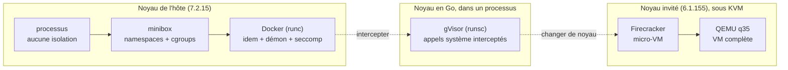
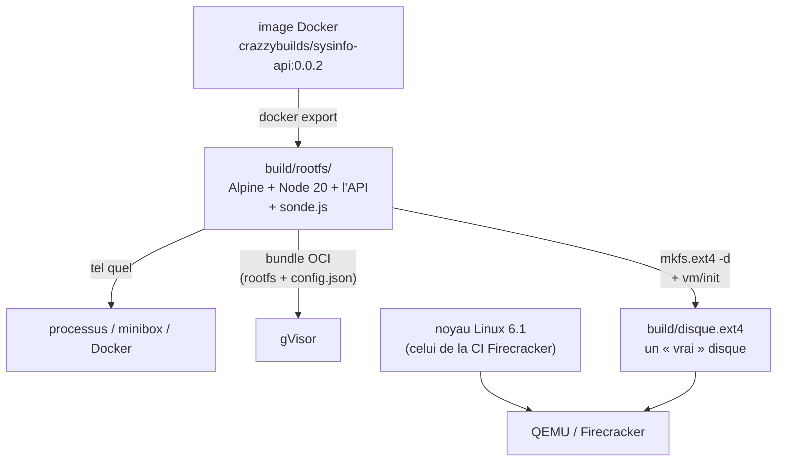
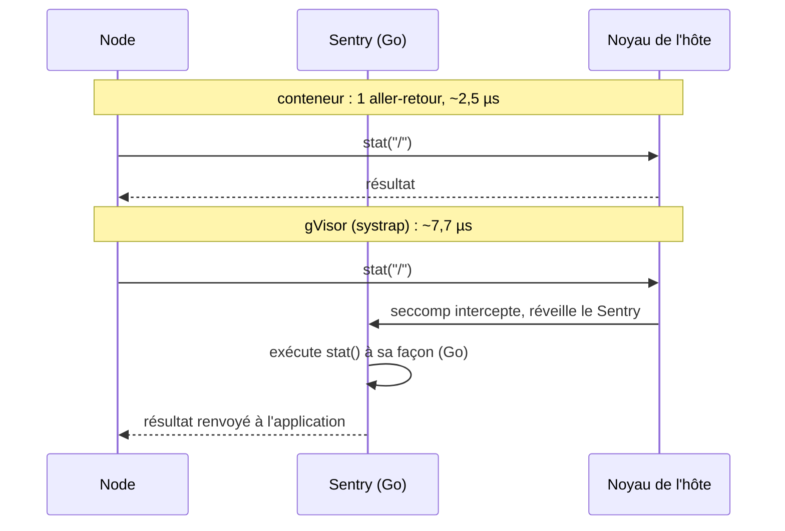
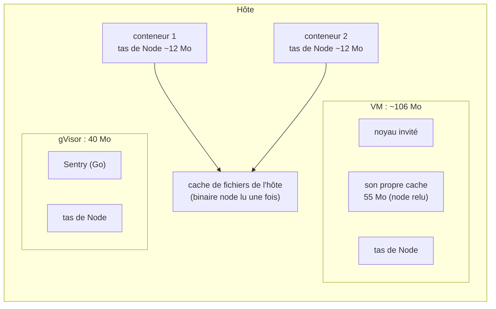

# Fiche — Piste 1 : le spectre de l'isolation

> **La question** : où finit le conteneur, où commence la machine virtuelle ?
> **La méthode** : lancer *le même programme*, sur *les mêmes fichiers*, à six
> niveaux d'isolation, et comparer ce qu'il voit, le temps de démarrage et la
> mémoire qu'il coûte à l'hôte.

---

## 1. Le spectre en une image

Chaque niveau ajoute une couche entre le programme et le matériel. La question
qui compte : **à qui le programme parle-t-il quand il fait un appel système ?**



- **Conteneurs** (processus, minibox, Docker) : le programme parle au **noyau
  de l'hôte**. L'isolation, ce sont des étiquettes que ce noyau pose sur le
  processus (namespaces = ce qu'il voit, cgroups = ce qu'il peut consommer).
- **gVisor** : le programme croit parler à Linux, mais ses appels système sont
  **capturés** et traités par le *Sentry*, un noyau réécrit en Go qui tourne
  comme un simple processus. Le Sentry, lui, ne fait qu'une poignée d'appels
  au vrai noyau.
- **VM** (Firecracker, QEMU) : le programme parle à **son propre noyau**, qui
  tourne sur un processeur virtuel. L'hôte ne voit qu'un seul processus :
  `firecracker` ou `qemu-system-x86_64`.

> [!tip] À retenir
> La frontière conteneur / VM, c'est **le noyau**. Un conteneur partage celui de
> l'hôte, une VM en a un à elle. gVisor est entre les deux : un noyau à lui,
> mais qui n'est qu'un programme sur le noyau de l'hôte.

---

## 2. Le dispositif



- **Les mêmes fichiers partout** : le système de fichiers de ton image du TD2.
  Pour les VM, on le met dans un fichier-disque ext4 (`mkfs.ext4 -d` remplit
  le disque à partir d'un dossier, sans root).
- **Le même Node partout** (v20 de l'image). Même sur l'hôte, on le lance via le
  chargeur musl du rootfs (voir les pièges, §8).
- **Le même noyau pour les deux VM**, pour comparer les VMM et pas les noyaux.
- **gVisor sans Docker** : `runsc` lit un *bundle OCI*, c'est-à-dire un dossier
  racine + un `config.json` (le processus à lancer, ses montages, ses
  namespaces). C'est exactement ce que Docker prépare et passe à runc.
- **Dans une VM, personne ne prépare l'environnement** : c'est notre script
  `vm/init` (PID 1) qui monte `/proc`, `/sys`, `/dev`, lance la sonde puis
  éteint la machine avec `reboot -f`.

**Les trois mesures :**

| Mesure | Comment | Script |
|---|---|---|
| Ce que voit le programme | `sonde.js` : noyau, hostname, mémoire, CPU, processus, uptime du noyau, cache, coût d'un `stat()` | `mesurer.sh` |
| Démarrage | lancer **`/bin/true`** (qui ne fait rien) → coût pur de l'isolation, médiane sur 10 | `mesurer.sh` |
| Mémoire côté hôte | l'API au repos ; on lit `memory.stat` (`anon` + `shmem`) du cgroup qui la contient | `memoire.sh` |

---

## 3. Résultats

Machine : Ryzen 5 5500H (8 threads), 15 Go, noyau 7.2.15, KVM. Tout tourne
**sans root**.

| Niveau | Démarrage | Noyau vu | Mémoire vue | CPU | Processus vus | Noyau lancé depuis | Cache vu | `stat()` | Mémoire hôte |
|---|---|---|---|---|---|---|---|---|---|
| processus | **2 ms** | 7.2.15 | 15 326 Mo | 8 | 553 | 3 h 44 | 6 214 Mo | 2,5 µs | 14 Mo |
| minibox | **9 ms** | 7.2.15 | 15 326 Mo | 8 | 2 | 3 h 44 | 6 217 Mo | 2,7 µs | 13 Mo |
| Docker | **415 ms** | 7.2.15 | 15 326 Mo | 8 | 2 | 3 h 44 | 6 303 Mo | 2,6 µs | 11 Mo |
| gVisor | **52 ms** | **4.19.0-gvisor** | 15 326 Mo | 8 | 2 | **0,57 s** | **56 Mo** | **7,7 µs** | **40 Mo** |
| Firecracker | **154 ms** (dont noyau 70) | **6.1.155** | **482 Mo** | **1** | 53 | **0,26 s** | **55 Mo** | 2,7 µs | **106 Mo** |
| QEMU q35 | **472 ms** (dont noyau 260) | **6.1.155** | **482 Mo** | **1** | 52 | **0,59 s** | **55 Mo** | 2,9 µs | **125 Mo** |

Le coût de `stat()` varie d'environ ±10 % d'une série à l'autre : seuls les
écarts plus grands que ça veulent dire quelque chose (ici, seul gVisor).

---

## 4. Lecture n° 1 : ce que voit le programme

**Dans un conteneur, le programme voit l'hôte**, sauf ce que les namespaces
cachent :

- ✅ caché : les autres processus (2 au lieu de 553 : namespace PID), le nom
  de la machine (namespace UTS), les fichiers (namespace mount).
- ❌ pas caché : **le noyau** (7.2.15, démarré il y a presque 4 h), **la mémoire
  totale** (15 Go), **les CPU** (8), **le cache de fichiers** de l'hôte. Même
  avec une limite cgroup, `/proc/meminfo` montre la machine entière (c'est pour
  ça que minibox a l'option `-fake-meminfo`, piste 2, étape 7).

**Dans gVisor, le programme voit un noyau qui n'existe pas** : `4.19.0-gvisor`
est une version *inventée* par le Sentry (il imite l'interface de Linux 4.19,
il n'en contient pas une ligne). Son uptime, son cache de fichiers, ses
processus : tout vient du Sentry. Par contre, il reprend la mémoire et les CPU
de l'hôte (aucune limite n'a été demandée).

**Dans une VM, le programme voit une autre machine** : un autre noyau, démarré
il y a un quart de seconde, 482 Mo (les 512 Mo donnés moins ce que le noyau se
réserve), 1 CPU. Les ~50 « processus » sont surtout des *threads du noyau
invité* (`kworker`, `ksoftirqd`…) : dans un conteneur ils sont cachés, parce que
ceux de l'hôte n'appartiennent pas au namespace PID.

> [!example] Le lien avec le TD4
> Sur Azure Container Instances, la même API voyait **1 CPU, 1,45 Gio, un noyau
> `6.1.158.2-microsoft-standard`**, `system.virtual: true`. Exactement la
> signature de nos lignes Firecracker / QEMU, et pas celle de la ligne Docker.
> Le « conteneur » Azure tourne donc dans une **petite VM dédiée** : entre
> clients différents, partager un noyau serait trop risqué.
> (Google fait l'autre choix pour Cloud Run première génération : gVisor.)

---

## 5. Lecture n° 2 : le démarrage

```mermaid
gantt
    title Démarrer puis arrêter « rien » (/bin/true), en ms
    dateFormat x
    axisFormat %L
    section minibox
    clone + pivot_root + exec      :0, 9
    section gVisor
    runsc + Sentry + gofer         :0, 52
    section Firecracker
    noyau invité                   :0, 70
    VMM + extinction               :70, 154
    section Docker
    client → dockerd → containerd → shim → runc :0, 415
    section QEMU q35
    noyau invité                   :0, 260
    VMM + firmware + extinction    :260, 472
```



Quatre constats :

1. **minibox est ~50× plus rapide que Docker**, alors que le cœur est le même
   (namespaces + cgroups). Le temps de Docker, c'est la *chaîne* : le client
   parle au démon par une socket, qui délègue à containerd, qui lance un shim,
   qui lance runc ; plus la préparation de l'overlay et du réseau (veth,
   bridge). Le conteneur lui-même ne coûte que quelques millisecondes.
2. **gVisor démarre en ~50 ms** : pas de matériel à découvrir, juste trois
   processus à lancer (le Sentry, le gofer et le processus de l'application).
3. **Une micro-VM démarre plus vite qu'un `docker run`**. Pas besoin de
   « démarrer un ordinateur » si l'ordinateur est minuscule.
4. **Firecracker vs QEMU, même noyau : 70 ms contre 260 ms** dans le noyau. La
   différence, c'est le matériel à découvrir :

| | QEMU q35 | Firecracker |
|---|---|---|
| Firmware | SeaBIOS (un vrai BIOS émulé) | aucun : il charge le noyau et saute dedans |
| Bus | PCI Express, ACPI | aucun : le disque est annoncé sur la ligne de commande (`virtio_mmio.device=4K@0xc0001000:5`) |
| Périphériques | chipset Intel complet, des dizaines de périphériques possibles | 5 : virtio-blk, virtio-net, virtio-vsock, port série, i8042 minimal (sert juste à éteindre la VM) |
| Code du VMM | > 1,4 million de lignes (C) | ~50 000 lignes (Rust) |

Moins de matériel = moins à détecter au démarrage, **et moins de code exposé à
un attaquant** qui sortirait du noyau invité. C'est pour ça qu'AWS a écrit
Firecracker pour Lambda et Fargate (Agache et al., *Firecracker: Lightweight
Virtualization for Serverless Applications*, NSDI 2020, d'où viennent les
tailles de code ci-dessus).

---

## 6. Lecture n° 3 : les appels système

C'est la mesure qui sépare gVisor de tous les autres.



- **Conteneurs et VM : ~2,5 µs partout.** Avec KVM, un appel système **ne sort
  pas de la VM** : le processeur exécute le noyau invité directement, sans
  passer par l'hyperviseur.
- **gVisor : 7,7 µs, 3× plus.** Chaque appel système est intercepté (par un
  filtre seccomp, mode `systrap`) et renvoyé au Sentry, qui le traite en Go.
  Avec le mode `--platform=kvm` (le Sentry tourne alors dans une VM et joue
  le rôle de noyau invité), on descend à 4,6 µs : mieux, mais toujours 2×
  plus qu'un vrai noyau.
- **Ce qui coûte cher dans une VM**, ce sont les **sorties vers le VMM**
  (« VM exits »), à chaque accès à un périphérique émulé. La preuve (§8, piège
  n° 4) : sans l'option `quiet`, la VM QEMU mettait 1,7 s au lieu de 0,46 s, car
  **chaque caractère** écrit sur le port série émulé est une sortie vers QEMU.

**Ce qu'on voit de gVisor depuis l'hôte** (le cgroup de l'API) :

```text
runsc            ← la commande lancée, qui orchestre
runsc-gofer      ← sert les fichiers au Sentry (lui n'a pas le droit de les ouvrir)
runsc-sandbox    ← le Sentry : le noyau en Go
gvisor_sentry ×5 ← des « coquilles » où s'exécute le code de Node
processus « node » sur l'hôte : 0
```

L'hôte ne sait même pas que c'est Node qui tourne. Et si Node trouve une faille
dans « le noyau », il la trouve dans le Sentry, qui lui-même n'a presque aucun
droit sur le vrai noyau.

---

## 7. Lecture n° 4 : la mémoire

**Mémoire côté hôte** pour l'API au repos : ~12 Mo dans un conteneur, 40 Mo
dans gVisor, ~110 Mo dans une VM.



- Un conteneur **partage le cache de fichiers de l'hôte** : le binaire `node`
  (~55 Mo) est en mémoire une seule fois, quel que soit le nombre de conteneurs.
- Une VM a **son propre noyau et son propre cache** : elle relit `node` depuis
  son disque virtuel, dans *sa* RAM. Pour l'hôte, c'est de la mémoire
  anonyme du processus `firecracker`, **dupliquée dans chaque VM**.
- gVisor ajoute ~25 Mo, le Sentry et sa gestion de la mémoire. Détail
  qui piège : la mémoire de l'application n'y est pas de la mémoire `anon`
  ordinaire. Le Sentry la range dans un **fichier mémoire partagé** (`shmem`,
  11 Mo ici) qu'il distribue à ses processus coquilles. Compter seulement
  `anon` donnait 30 Mo au lieu de 40 (piège n° 8).
- Pas de noyau ni de RAM de VM à réserver : gVisor reste 3× moins cher en
  mémoire qu'une micro-VM.
- La RAM d'une VM n'est allouée que quand l'invité la touche : 512 Mo donnés,
  ~110 Mo réellement utilisés.

> [!tip] À retenir
> | | Isolation | Coût principal |
> |---|---|---|
> | Conteneur | **logique** : un seul noyau partagé (une faille du noyau = tout le monde est touché) | presque rien |
> | gVisor | un noyau en Go **entre** l'appli et le vrai noyau | les appels système (×3) |
> | VM | **matérielle** : le processeur la garantit | la mémoire (~100 Mo par VM) et les périphériques émulés |

---

## 8. Les pièges rencontrés (et ce qu'ils apprennent)

| # | Symptôme | Cause | Leçon |
|---|---|---|---|
| 1 | La sonde met 5 s dans minibox, 0,4 s dans Docker | `os.hostname()` → recherche DNS de « minibox », sans `/etc/hosts` ni DNS : 5 s de timeout | Docker écrit `/etc/hosts` et `/etc/resolv.conf` dans chaque conteneur. minibox le fait maintenant aussi, et on en fournit un à gVisor |
| 2 | Le noyau plante (`divide error`) dans QEMU `microvm` | la console série de ce mode ne convient pas au noyau Firecracker | un VMM, c'est un contrat précis avec le noyau ; passage en `q35` |
| 3 | Firecracker plus lent que QEMU (660 ms) | le noyau attend 0,5 s un clavier PS/2 que Firecracker n'émule pas | options `i8042.noaux i8042.nomux i8042.nopnp i8042.dumbkbd` (doc Firecracker) → 154 ms |
| 4 | QEMU : 1,7 s | les messages du noyau sur le port série : une sortie VM par caractère | option `quiet` → 0,46 s |
| 5 | `stat()` 25 % plus rapide sans isolation ?! | l'hôte utilisait son Node v26 (glibc), les autres le v20 de l'image (musl) | **comparer à armes égales** : lancer le Node de l'image sur l'hôte via `ld-musl-x86_64.so.1` → l'écart disparaît |
| 6 | `runsc` : `gvisor_sentry: no such file` | les versions récentes découpent gVisor en plusieurs binaires (`gvisor-bin/` à côté de `runsc`) | installer toute l'archive, pas seulement `runsc` |
| 7 | Docker à 1 681 ms sur une série, ~400 ms sur les autres | le démon Docker est partagé avec d'autres conteneurs actifs sur la machine | une mesure isolée ne prouve rien : **répéter** (médianes, plusieurs séries) |
| 8 | gVisor à 30 Mo, alors que l'appli seule en fait ~12 | la mémoire de l'appli est dans un fichier mémoire partagé (`shmem`), pas dans `anon` | savoir **ce que compte** un compteur avant de comparer : on compte maintenant `anon + shmem` partout |

Le piège n° 5 est le plus important : sans lui, on aurait « prouvé » que
l'isolation ralentit les appels système de 25 %. **Une mesure ne vaut que si on
ne change qu'une chose à la fois.**

---

## 9. Reproduire

```sh
./preparer-rootfs.sh            # build/rootfs depuis l'image Docker
vm/preparer-disque.sh           # build/disque.ext4 pour les VM
# noyau : vmlinux-6.1.155 de la CI Firecracker, dans build/noyau/
./mesurer.sh gvisor             # une ligne JSON par niveau
./memoire.sh gvisor
```

Niveaux : `processus minibox docker gvisor qemu firecracker`. Aucun n'a besoin
de root (`/dev/kvm` accessible à l'utilisateur, Docker déjà installé, gVisor en
mode `--rootless`).

---

## 10. Questions pour vérifier

<details><summary>1. Pourquoi la sonde voit-elle 15 Go de mémoire dans Docker mais 482 Mo dans Firecracker ?</summary>
Dans Docker, <code>/proc/meminfo</code> est produit par le noyau de l'hôte, qui décrit la machine entière (les namespaces ne cachent pas la mémoire). Dans Firecracker, c'est le noyau invité qui répond, et sa machine n'a que 512 Mo (moins sa réserve).
</details>

<details><summary>2. Pourquoi ~50 processus dans la VM et 2 dans minibox ?</summary>
Dans la VM, la sonde voit les threads du noyau invité (kworker…). Dans minibox, le namespace PID ne montre que les processus créés dedans ; les threads du noyau de l'hôte en sont exclus.
</details>

<details><summary>3. Comment savoir, depuis l'intérieur, si on est dans un conteneur, gVisor ou une VM ?</summary>
Regarder le noyau et son uptime : même noyau que l'hôte, démarré il y a longtemps → conteneur ; « 4.19.0-gvisor » → gVisor ; noyau différent démarré il y a quelques instants, avec peu de CPU et de mémoire → VM.
</details>

<details><summary>4. Pourquoi minibox démarre-t-il 50× plus vite que Docker ?</summary>
Le cœur est identique (clone avec namespaces, cgroup, pivot_root, exec). Docker ajoute une chaîne de démons (dockerd, containerd, shim, runc) reliés par des sockets, plus la préparation de l'overlay et du réseau.
</details>

<details><summary>5. Pourquoi le même noyau démarre-t-il 4× plus vite dans Firecracker que dans QEMU q35 ?</summary>
Moins de matériel à découvrir : pas de BIOS, pas de PCI ni d'ACPI à énumérer, 5 périphériques. Le disque est annoncé directement sur la ligne de commande du noyau.
</details>

<details><summary>6. Pourquoi un appel système coûte-t-il 3× plus dans gVisor, mais presque rien de plus dans une VM ?</summary>
Dans gVisor, chaque appel est intercepté (seccomp) et traité par le Sentry, un programme Go : il y a des allers-retours en plus. Dans une VM, le processeur exécute le noyau invité directement (virtualisation matérielle) : l'appel va du programme au noyau invité sans sortir de la VM.
</details>

<details><summary>7. Qu'est-ce que l'hôte voit d'une API Node qui tourne dans gVisor ?</summary>
Aucun processus « node » : seulement runsc, le gofer (qui sert les fichiers), le Sentry et des processus « coquilles » gvisor_sentry dans lesquels le code de Node s'exécute.
</details>

<details><summary>8. Où partent les ~95 Mo de plus d'une VM ? Et pourquoi gVisor coûte-t-il moins ?</summary>
Dans son propre noyau et son propre cache de fichiers (le binaire node relu depuis le disque virtuel, 55 Mo), dupliqués dans chaque VM. gVisor n'a ni noyau invité ni RAM de VM : il ajoute seulement le Sentry (~25 Mo).
</details>

<details><summary>9. Pourquoi Azure (TD4) met-il les conteneurs dans des VM ?</summary>
Des conteneurs de clients différents tournent sur les mêmes serveurs. Partager le noyau = une faille du noyau permettrait de sortir vers les autres clients. Une petite VM garde un démarrage rapide tout en ajoutant la frontière matérielle de l'hyperviseur.
</details>

<details><summary>10. Pourquoi la mesure de stat() était-elle fausse au début ?</summary>
Deux choses changeaient en même temps : l'isolation et la version de Node (v26 glibc sur l'hôte, v20 musl ailleurs). En lançant le Node de l'image sur l'hôte, l'écart disparaît : c'était Node, pas l'isolation.
</details>

<details><summary>11. Pourquoi « quiet » accélère-t-il autant le démarrage de QEMU ?</summary>
Chaque caractère écrit sur le port série émulé est une écriture sur un port d'E/S, qui provoque une sortie de la VM vers QEMU (VM exit). Des milliers de caractères = des milliers d'allers-retours.
</details>
